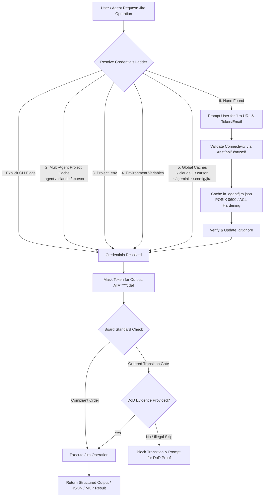
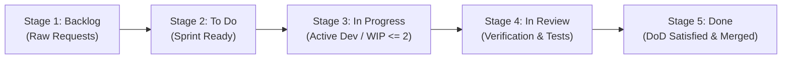

# Jira Management Skill

A cross-platform, enterprise-grade skill and SDK for managing Jira Cloud and Jira Data Center/Server workspaces across **all AI coding agents and IDEs** (Anthropic Claude, Cursor IDE, Windsurf, GitHub Copilot, Cline, Roo Code, Google Antigravity, and universal LLMs). Securely caches API tokens on a per-project basis, enforces standardized agile board workflows, executes sequential issue lifecycles with Definition of Done (DoD) verification gates, provides a built-in Model Context Protocol (MCP) server, and orchestrates sprints.

---

## 🧭 Workflow & Token Resolution Architecture

Whenever Jira operations are requested, the agent resolves credentials and project context following this automated flow:



---

## 🔐 Zero-Leak Credential Resolution Ladder

Credentials are automatically resolved in the following strict priority order:

1. **Explicit Flags**: `--url <URL> --token <TOKEN> [--email <EMAIL>]`
2. **Project Caches**:
   - `<project_root>/.agent/jira.json`
   - `<project_root>/.claude/jira.json`
   - `<project_root>/.cursor/jira.json`
3. **Project `.env` File**: `JIRA_URL`, `JIRA_EMAIL`, `JIRA_API_TOKEN` (or `JIRA_PAT`)
4. **Process Environment**: `os.environ["JIRA_URL"]`, `os.environ["JIRA_API_TOKEN"]`
5. **Global User Caches**:
   - `~/.gemini/config/jira.json` (Google Antigravity)
   - `~/.claude/jira.json` (Anthropic Claude)
   - `~/.cursor/jira.json` (Cursor IDE)
   - `~/.config/jira/jira.json` (Linux / XDG Standard)
   - `~/.jira/jira.json` or `~/.jira/config.json`

### 🛡️ Safety & Per-Project Caching Directives
- **Automatic `.gitignore` Protection**: Caching credentials automatically verifies that `.agent/`, `.claude/jira.json`, `.cursor/jira.json`, and `.env*` are listed in the project's `.gitignore`. If missing, they are appended automatically.
- **Strict File Permissions**:
  - **POSIX (Linux/macOS)**: Directory permissions `0700` (`rwx------`), file permissions `0600` (`rw-------`).
  - **Windows**: Stored within user-owned directories with restricted inheritance.
- **Zero Raw Secret Leaks**: Tokens are never displayed or logged in full. The CLI masks all secrets (e.g. `ATAT***cdef`).

---

## 📋 The Enforced Board Ordering Protocol

Every project adopting this skill **must** initialize or link a Jira board conforming to the Skill Ordered Standard. All tasks must follow this strict sequential lifecycle:



### 1. Mandatory Stages & Recognized Statuses
1. **Stage 1 (Backlog)**: `Backlog`, `Open`, `Submitted`, `New`, `Funnel`
2. **Stage 2 (To Do)**: `To Do`, `Selected for Development`, `Ready`, `Planned`, `Sprint Backlog`
3. **Stage 3 (In Progress)**: `In Progress`, `Active`, `Developing`, `Investigation`, `WIP`
4. **Stage 4 (In Review / Verification)**: `In Review`, `Review`, `Testing`, `QA`, `Verification`, `DoD Check`
5. **Stage 5 (Done)**: `Done`, `Closed`, `Resolved`, `Completed`, `Verified`

### 2. Golden Enforcement Rules
- **Rule 1 (No Forward Skips)**: An issue cannot jump directly from `Backlog` or `To Do` straight to `Done`. It must pass through `In Progress` and `In Review`.
- **Rule 2 (Definition of Done Gate)**: Transitioning from `In Review` to `Done` requires verification proof (automated test results, build confirmation, or PR review) provided via `--comment` or `--dod-report`.
- **Rule 3 (WIP Discipline)**: No autonomous agent may have more than **1 or 2 issues** active in `In Progress` at any time.
- **Rule 4 (Traceability)**: All Git branches and commit messages must cite the Jira issue key (e.g. `feat: [#PROJ-42] add login router`).

---

## ⚡ Cross-Platform CLI Quick Reference

The skill provides a pure Python CLI (`scripts/jira_cli.py`) with **zero external dependencies**, running out-of-the-box on Windows, Linux, and macOS.

Convenient wrapper scripts are provided:
- **Windows**: `powershell -ExecutionPolicy Bypass -File .\scripts\run.ps1 <subcommand>`
- **Linux / macOS**: `./scripts/run.sh <subcommand>`

---

### 1. Authentication & Cache Management (`auth`)

```bash
# Save and verify Atlassian Cloud credentials for current project
python scripts/jira_cli.py auth set \
  --url "https://mycompany.atlassian.net" \
  --email "developer@mycompany.com" \
  --token "ATATT3xFfGF0exampletoken123" \
  --project "PROJ" \
  --board-id 14

# Save Data Center / Server Personal Access Token (PAT) without email
python scripts/jira_cli.py auth set \
  --url "https://jira.internal.corp" \
  --token "my_secret_pat_here" \
  --project "CORE"

# Check authentication status and live bot connection (Zero-Leak masked)
python scripts/jira_cli.py auth status

# Return status in JSON format (ideal for subagents)
python scripts/jira_cli.py auth status --json

# Remove cached credentials
python scripts/jira_cli.py auth remove
```

---

### 2. Board Management & Compliance Auditing (`board`)

```bash
# List all boards accessible in project
python scripts/jira_cli.py board list --project PROJ

# View board details and column mappings
python scripts/jira_cli.py board config --board-id 14

# Audit board against the Skill Ordered Standard (scores compliance 0-100%)
python scripts/jira_cli.py board audit --board-id 14

# Visual ASCII view of board columns with issues bucketed in standard order
python scripts/jira_cli.py board view --board-id 14

# JSON export of board issues grouped by ordered stages
python scripts/jira_cli.py board view --board-id 14 --json
```

---

### 3. Issue Lifecycle & DoD Verification Gates (`issue`)

```bash
# Create an issue
python scripts/jira_cli.py issue create \
  --project PROJ \
  --summary "Implement OAuth2 Token Refresh" \
  --type "Task" \
  --description "Ensure expired access tokens refresh automatically via background interceptor." \
  --priority "High" \
  --labels "backend,security"

# Inspect issue details
python scripts/jira_cli.py issue get --key PROJ-101

# Start working on issue: To Do -> In Progress
python scripts/jira_cli.py issue transition --key PROJ-101 --to "In Progress"

# Submit for verification: In Progress -> In Review
python scripts/jira_cli.py issue transition --key PROJ-101 --to "In Review"

# Transition to Done (enforces DoD verification gate)
python scripts/jira_cli.py issue transition \
  --key PROJ-101 \
  --to "Done" \
  --comment "Verified: 18 unit tests passed, JWT refresh cycle verified against mock server."

# Transition to Done attaching a full test log file as DoD evidence
python scripts/jira_cli.py issue transition \
  --key PROJ-101 \
  --to "Done" \
  --dod-report "./tests/test_results.log"

# Add a comment to an issue
python scripts/jira_cli.py issue comment --key PROJ-101 --body "Branch feature/#PROJ-101-auth pushed to remote."

# Log work time
python scripts/jira_cli.py issue worklog --key PROJ-101 --time "2h 30m" --comment "Implemented interceptor tests."

# Search issues with JQL
python scripts/jira_cli.py issue search --jql "project = PROJ AND statusCategory != Done ORDER BY priority DESC"
```

---

### 4. Sprint & Agile Operations (`sprint`)

```bash
# List sprints for a Scrum board
python scripts/jira_cli.py sprint list --board-id 14 --state active

# List issues in a specific sprint
python scripts/jira_cli.py sprint issues --sprint-id 42

# Create a new sprint
python scripts/jira_cli.py sprint create \
  --board-id 14 \
  --name "Sprint 2026-Q4-S1" \
  --goal "Deliver authentication engine and API integrations"
```

---

### 5. Project Information (`project`)

```bash
# List accessible Jira projects
python scripts/jira_cli.py project list

# Inspect project details
python scripts/jira_cli.py project get --key PROJ
```

---

### 6. Multi-Agent Setup & MCP Configuration (`agents`)

The skill natively equips all major AI agents and IDEs with customized rules and MCP tool bindings.

```bash
# List supported agents and their integration status in current project
python scripts/jira_cli.py agents list

# Output status as JSON
python scripts/jira_cli.py agents list --json

# Setup instruction and rule files for all agents in current workspace
python scripts/jira_cli.py agents setup

# Setup rules for a specific agent (e.g., Cursor, Claude, Windsurf)
python scripts/jira_cli.py agents setup --agent cursor
python scripts/jira_cli.py agents setup --agent claude

# Export MCP configuration JSON
python scripts/jira_cli.py agents mcp-config

# Write MCP configurations directly to .cursor/mcp.json and .mcp.json
python scripts/jira_cli.py agents mcp-config --write
```

---

### 7. Zero-Dependency Model Context Protocol (MCP) Server (`mcp`)

Run the stdio MCP server for direct tool execution in Claude Desktop, Claude Code, Cursor, Windsurf, or Cline:

```bash
# Start MCP server over stdio
python -m jira_management mcp
# or
jira mcp
```

Exposed MCP Tools:
- `jira_auth_status`: Masked authentication and connection check.
- `jira_board_audit`: Agile board compliance scoring against 5-stage standard.
- `jira_board_view`: Stage-bucketed board issues inspection.
- `jira_create_issue`: Create Jira task/bug with markdown description.
- `jira_get_issue`: Detailed issue inspection with current stage mapping.
- `jira_transition_issue`: Sequential transitions enforcing DoD gate verification.
- `jira_comment_issue`: Add issue comments.
- `jira_worklog_issue`: Log time spent with descriptions.
- `jira_search_issues`: JQL query execution.
- `jira_list_projects`: Workspace projects list.
- `jira_list_sprints`: Scrum board sprint list.

---

## 🤖 Supported AI Agents & Integration Matrix

| Agent / IDE | Configuration File(s) | Native Support Mode |
| :--- | :--- | :--- |
| **Universal Agents** | [AGENTS.md](file:///d:/Projects/Personal/agent-jira-integration/AGENTS.md) | Standardized LLM prompt & CLI |
| **Anthropic Claude & Claude Code** | [CLAUDE.md](file:///d:/Projects/Personal/agent-jira-integration/CLAUDE.md), [.mcp.json](file:///d:/Projects/Personal/agent-jira-integration/.mcp.json) | CLI instructions + MCP server |
| **Cursor IDE** | [.cursorrules](file:///d:/Projects/Personal/agent-jira-integration/.cursorrules), [.cursor/rules/jira-management.mdc](file:///d:/Projects/Personal/agent-jira-integration/.cursor/rules/jira-management.mdc), [.cursor/mcp.json](file:///d:/Projects/Personal/agent-jira-integration/.cursor/mcp.json) | Cursor Composer rules + MCP server |
| **Windsurf / Codeium** | [.windsurfrules](file:///d:/Projects/Personal/agent-jira-integration/.windsurfrules) | Cascade rules + CLI |
| **GitHub Copilot** | [.github/copilot-instructions.md](file:///d:/Projects/Personal/agent-jira-integration/.github/copilot-instructions.md) | Copilot Workspace & Chat |
| **Cline & Roo Code** | [.clinerules](file:///d:/Projects/Personal/agent-jira-integration/.clinerules) | Autonomous agent rules + MCP server |
| **Google Antigravity** | [SKILL.md](file:///d:/Projects/Personal/agent-jira-integration/SKILL.md) | Native Antigravity Skill Engine |

---

## 🤖 Subagent Sandboxing & Integration Pattern

When autonomous agents or subagents interact with Jira, adhere to the following contract:

1. **Verify Authentication First**:
   ```bash
   python scripts/jira_cli.py auth status --json
   ```
2. **Audit Project Board**:
   ```bash
   python scripts/jira_cli.py board audit --json
   ```
3. **Execute Work in Sequential Order**:
   - Transition task to `In Progress`.
   - Implement the code and execute automated tests (Priority 5: Ground-Truth Verification).
   - Transition task to `In Review`.
   - Transition task to `Done` with `--dod-report` or verification notes.
4. **Return Compact Summary**:
   Subagents report back only the issue keys, transitions performed, and verification links (< 300 tokens).

---

## 📚 Reference Documentation
- **[board-workflow-standard.md](file:///d:/Projects/Personal/agent-jira-integration/references/board-workflow-standard.md)**: Mandatory board stages, transition rules, and DoD gate specifications.
- **[jira-api-reference.md](file:///d:/Projects/Personal/agent-jira-integration/references/jira-api-reference.md)**: Jira Cloud REST v3 / Data Center v2 endpoints, ADF syntax, and JQL patterns.
- **[security-and-caching.md](file:///d:/Projects/Personal/agent-jira-integration/references/security-and-caching.md)**: Zero-Leak credential isolation, `.agent/jira.json` schema, and POSIX permissions.
- **[AGENTS.md](file:///d:/Projects/Personal/agent-jira-integration/AGENTS.md)**: Universal multi-agent agile instructions.
- **[CLAUDE.md](file:///d:/Projects/Personal/agent-jira-integration/CLAUDE.md)**: Anthropic Claude and Claude Code guidelines.
