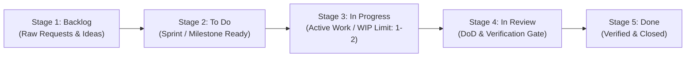

# Jira Skill Ordered Board Standard & Lifecycle Specification

This specification establishes the mandatory **Agile Board Standard and Lifecycle Order** required for every project utilizing the `jira-management` skill.

---

## 🧭 The 5 Mandatory Ordered Stages

Every project board linked to an agent workspace **must** define and maintain columns adhering to the following 5 sequential stages in strict left-to-right order:



| Order | Standard Stage | Category | Status Names Recognized | Purpose & Entry Criteria |
| :---: | :--- | :--- | :--- | :--- |
| **1** | **Backlog** | To Do | `Backlog`, `Open`, `Submitted`, `New`, `Funnel` | Unrefined requests, bugs reported, long-term roadmap items. Not yet scheduled or estimated. |
| **2** | **To Do** | To Do | `To Do`, `Selected for Development`, `Ready`, `Planned`, `Sprint Backlog` | Prioritized, estimated, and assigned to current sprint or active milestone. Definition of Ready (DoR) met. |
| **3** | **In Progress** | In Progress | `In Progress`, `Active`, `Developing`, `Investigation`, `WIP` | Active development by an agent or engineer. Maximum Work In Progress (WIP) limit: **1 to 2 items** per agent. |
| **4** | **In Review** | In Progress | `In Review`, `Review`, `Testing`, `QA`, `Verification`, `DoD Check`, `QA Ready` | Mandatory ground-truth verification stage. Tests executed, lint checks passed, code reviewed, DoD report generated. |
| **5** | **Done** | Done | `Done`, `Closed`, `Resolved`, `Completed`, `Verified` | All Definition of Done criteria satisfied. Code committed, verified, and released. |

---

## 🛡️ The 5 Golden Rules of the Skill Order

### Rule 1: Strict Sequential Flow (No Forward Skips)
- Tasks **must** move forward through each sequential stage:
  $$\text{Backlog} \rightarrow \text{To Do} \rightarrow \text{In Progress} \rightarrow \text{In Review} \rightarrow \text{Done}$$
- **Prohibited**: Under no circumstances may an agent or automated script transition an issue directly from `Backlog` or `To Do` to `Done`.
- Direct jumps skip active implementation and verification, creating invisible regressions.

### Rule 2: Definition of Done (DoD) Verification Gate
- Transition from `In Review` (Stage 4) to `Done` (Stage 5) **strictly requires** evidence of ground-truth verification.
- When calling `jira issue transition --key <KEY> --to "Done"`, the agent must provide:
  - `--comment "<verification notes>"` OR
  - `--dod-report <path-to-test-log-or-report>`
- The verification evidence must include:
  1. Automated test run output (e.g. unit/integration test results).
  2. Build/compiler status (e.g. exit code 0).
  3. Git commit or pull request reference.

### Rule 3: Backward Flow & Rework
- If verification in `In Review` fails (e.g. tests fail, regressions found, review requested changes):
  - Transition the issue back to `In Progress` (Stage 3).
  - Add a comment explaining the failure trace and required fixes.
  - Fix the issue, re-run verification, and return to `In Review`.

### Rule 4: WIP (Work In Progress) Discipline
- Each autonomous subagent or developer may have at most **1 active issue** in `In Progress` at any time.
- Prevents context thrashing, half-finished tasks, and quadratic context bloat.

### Rule 5: Traceability Standard
- Every Git commit, branch name, or PR title must reference the Jira issue key:
  - Branch: `feature/#PROJ-101-auth-middleware` or `fix/#PROJ-204-login-bug`
  - Conventional Commit: `feat: [#PROJ-101] add JWT authentication middleware`

---

## 🔍 Board Auditing & Compliance Scoring

The skill includes automated compliance auditing to inspect board configurations:

```bash
python scripts/jira_cli.py board audit --board-id <BOARD_ID>
```

### Audit Scoring Criteria
- **100% (Fully Compliant)**: All 5 stages present, sequenced strictly left-to-right, and all statuses mapped.
- **85% - 99% (Conditionally Compliant)**: Minor unmapped custom status names, but core 5 stages intact.
- **< 85% (Non-Compliant)**: Missing mandatory stages (especially `In Review` or `In Progress`) or columns out of order. Transition restrictions will alert on violations until board columns are adjusted.
