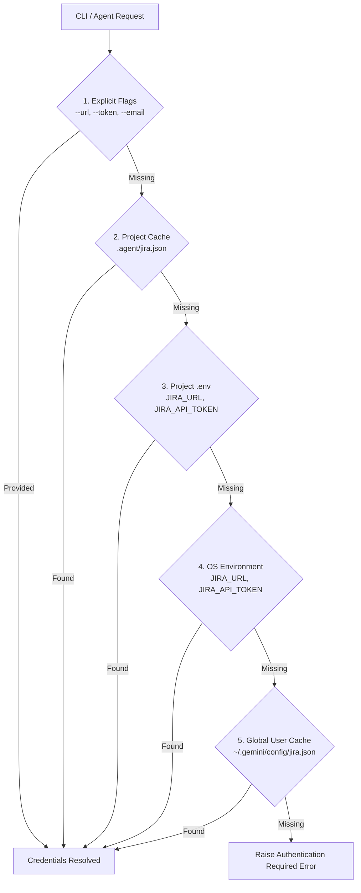

# Security & Zero-Leak Credential Protocol

This document outlines the security architecture, credential resolution ladder, and file hardening mechanisms implemented by the `jira-management` skill.

---

## 🪜 Credential Resolution Ladder

When any Jira command is invoked, credentials and project context are resolved in the following strict descending order:



---

## 🛡️ Zero-Leak Guarantees

### 1. Token Masking
- Raw API tokens, PATs, and passwords are **never** logged to stdout, stderr, or debug logs.
- Outputs display masked strings in the format `ATAT***cdef` or `secr***t_99`.

### 2. Automatic `.gitignore` Protection
- When saving credentials via `auth set`, the skill automatically checks the project root for `.gitignore`.
- If `.gitignore` exists and does not contain `.agent/`, the skill automatically appends:
  ```gitignore
  # Jira credentials & agent cache (Auto-added by jira-management skill)
  .agent/
  .env
  .env.*
  ```
- If `.gitignore` does not exist, a new one is created immediately before writing any secret to disk.

### 3. Filesystem Permission Hardening
- **POSIX (Linux / macOS)**:
  - Cache directory `.agent/`: `0700` (`rwx------`).
  - Cache file `jira.json`: `0600` (`rw-------`).
  - Prevents non-owner users from reading cached credentials on shared machines or servers.
- **Windows**:
  - Saved within the active user's Windows profile directory or local project directory owned by the developer user.

---

## 📂 `.agent/jira.json` Cache Schema

```json
{
  "version": "1.0",
  "profiles": {
    "default": {
      "url": "https://organization.atlassian.net",
      "email": "agent@organization.com",
      "token": "ATATT3xFfGF0...",
      "project": "PROJ",
      "board_id": 12,
      "updated_at": "2026-09-30T19:30:00Z",
      "user": {
        "account_id": "557058:example-account",
        "display_name": "Antigravity Jira Bot",
        "email_address": "agent@organization.com",
        "active": true,
        "account_type": "app"
      }
    }
  }
}
```
